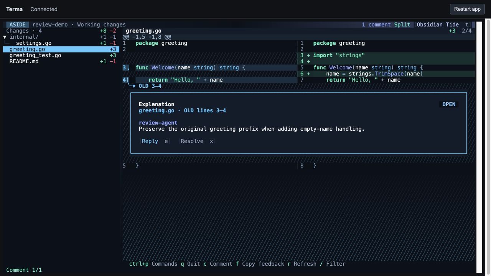

# Comment-to-code connections

27 September 2026 · Aside branch · macOS arm64

Comments now mark their exact source range in the line-number gutter. The first line starts a bracket, and the range continues beside the affected lines, including wrapped continuations. A connector above the card points from the correct gutter into the conversation and names the OLD or NEW range. In split view it follows the pane divider.

Selecting a comment with `[` / `]`, or clicking its line-range label, highlights that range's code and emphasizes the matching card. This distinguishes overlapping comments. New-comment composers get the same treatment. Diff colours, syntax highlighting, source text, and selection coordinates are preserved.

## Verification

| Check | Result |
| --- | --- |
| Full Go suite | 202 passed cases including subtests; no failures |
| Snapshot tests | 12 passed; all 8 changed/new goldens rendered and visually inspected |
| Static checks/build | `go vet ./...` and native Aside build passed; browser launcher built |
| Mouse | Clicking the range label selected the correct thread and displayed “Highlighted OLD lines 3–4” |
| Split view | Checked OLD 3–4 and NEW 6–7; opposite-pane source remained unhighlighted |
| Unified view | The same old-side range marked the old-number gutter and corresponding code |
| Narrow reply | Typed into the nested editor; wrapped code retained its range marks and connection |
| Resizing | Shifted the split divider with Ctrl+L; the connector followed its source pane |
| Incoming update/cancel | A second thread was deferred during editing, then appeared after Escape; the unsaved reply was absent from store read-back |
| Source integrity | Regression tests compare source/opposite-pane characters before and after decoration, then check old/new selection anchors |
| Edge cases | Regression coverage for overlapping ranges, another file, pending drafts, outdated snapshots, wrapped padding, and stacked cards |

Evidence: [test log](../snapshot-output/evidence/anchors/tests.jsonl), [summary and browser checks](../snapshot-output/evidence/anchors/summary.json), [vet output](../snapshot-output/evidence/anchors/vet.txt), [narrow reply](../snapshot-output/evidence/anchors/split-reply-narrow.jpg), [unified view](../snapshot-output/evidence/anchors/unified-old.jpg), [resized split](../snapshot-output/evidence/anchors/split-resized.jpg).

## Boundaries

A direct connector is drawn only when a card immediately follows its anchor. Additional cards at the same endpoint retain their clickable range labels and source highlighting; they do not draw a false connection from the preceding conversation. Outdated comments retain their original quote and never highlight current code at reused line numbers.

Ranges interrupted by another inline card remain highlighted in their separate code sections. Source selection across an existing card is still unavailable. No persistence or agent-protocol behavior changed; the race detector and live Claude/GitHub integrations were not rerun for this rendering change.

Verification used disposable repositories/review stores. Temporary browser tabs and launchers were closed, and the viewport override was reset.
