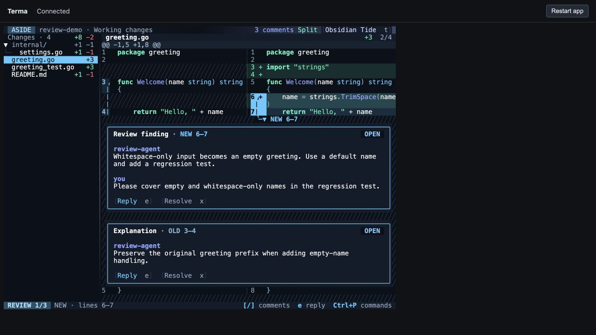

# Comment header and spacing verification

27 September 2026 · branch `aside`

Comment cards no longer repeat the filename. Their first line combines the kind, clickable OLD/NEW range, and status: `Review finding · NEW 6–7`. Single-line anchors display one number. Cards have one blank line before the first message, between messages, and between the final message and the action buttons. Internal padding remains Y: 0, X: 1.

| Check | Result |
| --- | --- |
| Full suite | 215 passed test cases, including subtests |
| Snapshots | 14 passed; all 9 changed goldens rendered and visually inspected |
| Layout coverage | Draft, outdated, reply, overlapping comments, single-line anchors, light theme, unified/split, and narrow widths |
| Browser | Checked the real native process at 100 columns and 80 columns |
| Mouse | Clicking OLD 3–4 in the headline selected the explanation and promoted it beneath its code |
| Build | Native `/tmp/aside` rebuilt; whitespace checks passed |

[Test results](../snapshot-output/evidence/comment-header/tests.jsonl). The browser used an isolated copy of the review store. Temporary sessions were stopped after testing. This is a presentation-only change; persistence code was untouched and the race detector was not rerun.
