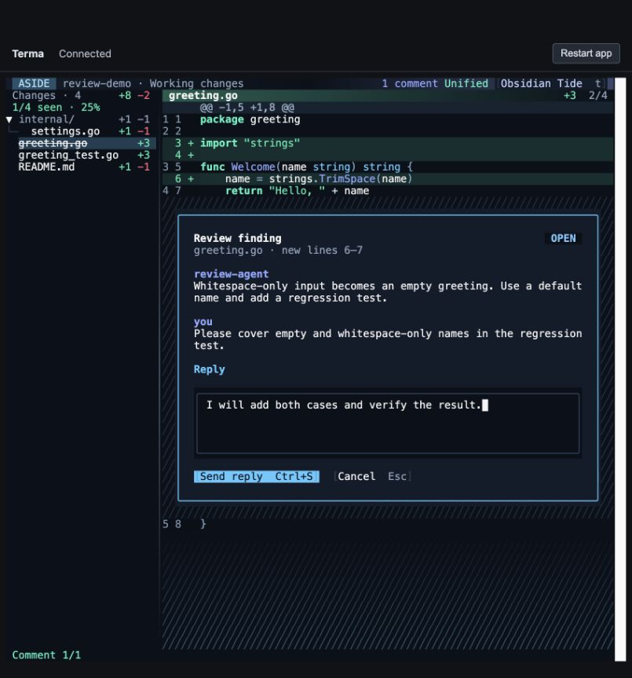

# Aside polish and dvdev comparison

**27 September 2026 · branch `aside` · macOS arm64**

The first Aside rewrite removed useful read-only features along with the Git mutation workflow. That was too broad. This follow-up restores the browsing conveniences listed below and implements the requested comment styling. It does not claim complete dvdev parity.

## Comment changes

- The diagonal hatch from dvdev's unused diff area now surrounds each comment card and standalone composer. A background widget sits behind the card; layout, focus, mouse actions, and source selection still belong to real widgets.
- Buttons display their own shortcuts: **Reply e**, **Resolve x**, **Send reply Ctrl+S**, **Cancel Esc**, and **Submit feedback f**. The separate composer legend and duplicate editing key bar were removed.
- Replies remain inside their thread. New-comment editors remain below the selected code.
- Draft submission gets a second action row so it stays visible at 65 columns.

## Comparison with dvdev

Compared against the committed `dvdev` version used as Aside's base (`a6932e9`). The original dv checkout and its uncommitted changes were not edited.

| Capability | Aside after this follow-up |
| --- | --- |
| Searchable command palette | Restored, `Ctrl+P`; contains browsing and review actions |
| Theme picker with preview/rollback | Restored, `t`; grouped light/dark themes and current selection |
| Coloured file and directory change totals | Restored |
| File position and compact path in the diff header | Restored |
| Header gradients, divider hover/focus colour, unused-space hatch | Restored |
| Seen-file marks and progress | Restored; session-local file marks, strikethrough, green title, file-count progress; changed content invalidates the mark |
| Per-file scroll memory | Restored; independent positions per layout and wrap mode |
| Sidebar visibility and keyboard resizing | Restored, `b` / `d` |
| Line-wrap toggle and horizontal scrolling | Restored, `w`, then left/right with the diff focused |
| Split resize/reset | Restored; `Ctrl+H` / `Ctrl+L`, plus reset in the palette |
| Intraline style and +/- visibility controls | Restored; `i` and palette |
| Copy code selection or file path | Restored, `y` |
| File navigation aliases and ten-line jumps | Restored |
| Fuzzy file filtering and highlights | Restored; filtered navigation and retained-filter clearing work together |
| Sidebar and +/- startup settings | Restored; `wrap` configuration also added |
| Directory/empty-state summary cards | Still simplified; directory aggregates appear in the sidebar, but the old detail cards are absent |
| Whitespace-ignore mode | Still absent |
| Piped diff input | Still absent |
| Source-line-preserving scroll mapping on a first layout switch | Not yet ported; stored positions restore on return, with raw-offset fallback on first switch |
| Branch-name metadata in the header | The current review title identifies the source; the old separate branch label is absent |
| Staging, committing, pushing, checkout, and PR creation | Remain removed from Aside |

`[` and `]` navigate comments in Aside; `n` / `p` and `Ctrl+J` / `Ctrl+K` navigate files. The seen percentage is based on files, rather than dvdev's line-weighted calculation. These are explicit differences, not full parity claims.

## Verification

| Check | Result |
| --- | --- |
| Full suite | **192 passed cases including subtests, 0 failures** |
| Visual snapshots | **9 passed**, all rendered and visually inspected |
| Race detector | Passed |
| `go vet ./...` | Passed, no diagnostics |
| Build | Native macOS arm64 executable built and exercised through Terma's browser PTY |
| Browser mouse interaction | Clicking Reply through the hatch frame opened the nested editor |
| Reply shortcut and persistence | Ctrl+S saved the text; CLI read-back confirmed the exact reply |
| Cancel | Escape removed the second unsaved reply; stored message count stayed at two |
| Theme preview | Filtering the palette to Theme, then Catppuccin Latte, changed the app live; Escape restored Obsidian Tide |
| Browsing controls | Seen marks, sidebar hide/restore, unified/split, and command filtering worked |
| Scroll and wrapping | An 80-line fixture restored its scrolled position after next/previous file; unwrapped lines scrolled horizontally; wrapping could be restored |
| Narrow layouts | Browser checked at 80 columns; 65-column snapshots cover outdated comments and draft controls |

The regression tests cover theme cancel/accept, blocking theme menus during composition, shortcuts following the focused thread, seen marks becoming invalid when the file changes, scroll memory per file and layout, fuzzy filtering, clearing a retained filter, selected-code/path copying, long-line horizontal scrolling, configuration precedence, and the absence of repository mutation commands in the palette.

Evidence: [test log](../snapshot-output/evidence/polish/tests.jsonl), [summary](../snapshot-output/evidence/polish/summary.json), [race result](../snapshot-output/evidence/polish/race.txt), and [browser checks](../snapshot-output/evidence/polish/manual-checks.json).

Additional screenshots: [split view](../snapshot-output/evidence/polish/split.jpg), [light-theme preview](../snapshot-output/evidence/polish/light-preview.jpg), and [narrow reply](../snapshot-output/evidence/polish/narrow-reply.jpg).

The test repository and data directory were disposable. No live Claude or GitHub integration was exercised in this UI follow-up. The earlier integration checks and limitations remain recorded in the [initial verification report](verification.md).
