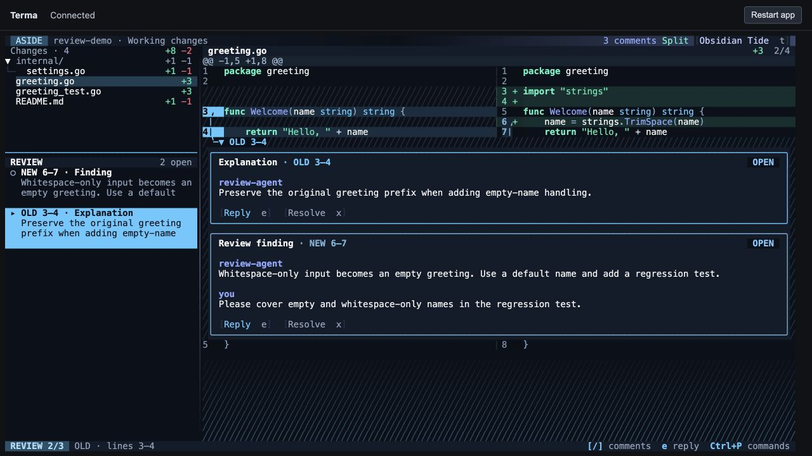
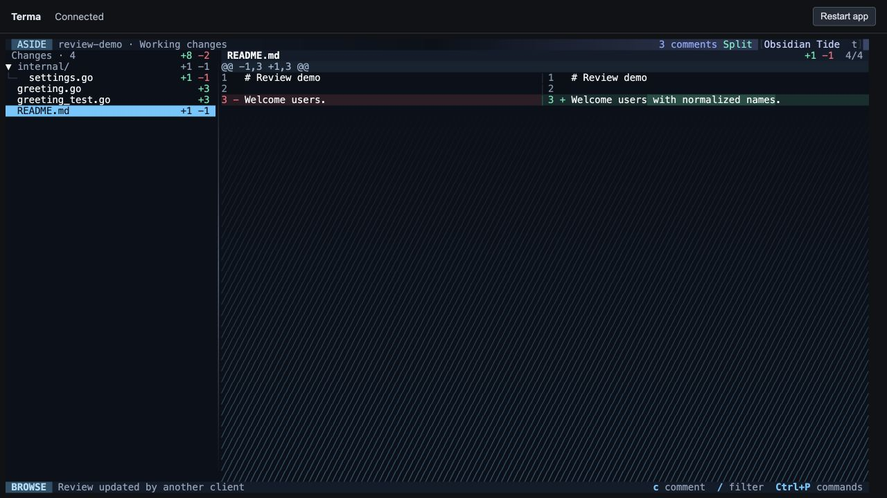
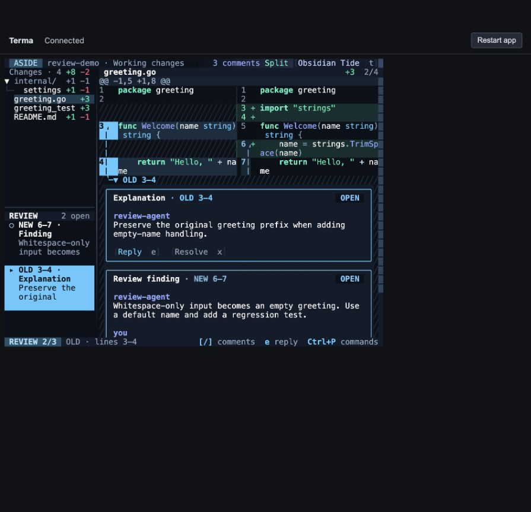

# Sidebar review navigator verification

Verified 28 September 2026 on the `aside` branch.

The sidebar now divides into a file tree and a review navigator for the selected file. Entries show the exact old/new range, comment kind, a two-line preview, and draft/outdated/resolved labels. Selection brings the corresponding card next to its highlighted code. Files without comments regain the full sidebar.

This uses Terma’s existing `List`, `ListState`, `Scrollable`, `ScrollState`, `SplitPane`, `Dock`, `Row`, `Column`, and `Text` components. The existing focus-aware split wrapper keeps the divider out of normal Tab traversal. No custom list navigation, scrolling, mouse-drag implementation, or terminal painting was added.

## Automated results

| Check | Result |
| --- | --- |
| `go test -json ./...` | 222 passing test cases, no failures |
| Aside snapshot suite | 16 passed; 2 new goldens, 9 existing goldens updated |
| Visual inspection | All 11 new/changed snapshots rendered to PNG and inspected |
| `go test -race ./...` | Passed |
| `go vet ./...` | Passed, no findings |
| `git diff --check` | Passed |

Behavior tests cover following the current file and `[`/`]` selection, resolve-state changes, empty filters, returning from a file without comments, cursor identity when preceding comments are removed, incoming updates during an unsent reply, End/Up navigation through 20 entries, independent file-tree and review scrolling, and blank/long/Unicode/control-containing previews.

Browser testing caught an initial hit-target bug: row padding selected a comment but child text did not. The fix assigns the same click handler to the row and its text/layout children. The regression test now clicks every cell in the rendered entry, rather than testing only its padding; it failed before the fix and passes afterward.

## Browser checks

The native Aside binary ran through `terma-browser` and its PTY, using a disposable fixture repository and an isolated copy of the review store. The default browser viewport was 1280 × 720. Test data contained old- and new-side comments and a saved reply.

| Action | Observed result |
| --- | --- |
| Click the explanation’s preview text | OLD 3–4 selected; matching code highlighted and explanation promoted directly below it |
| Navigate with Up/Down and Enter | Selection follows the list; Enter returns focus to the diff |
| Drag the horizontal divider upward | Review pane grows, file tree shrinks, diff remains unchanged |
| Ctrl+P → Resize review navigator → Down twice | Divider moves downward; Escape exits resize mode |
| Select README, which has no comments | Review pane and divider disappear; file tree uses full height |
| Fixed 80 × 32 terminal: `o`, then Down | Wrapped navigator entry is selected; OLD 3–4 and its explanation are visible together |

## Scope and limits

Previews use the first nonempty line of a comment and show at most two rows. The navigator includes both findings and explanations; ordered walkthrough chapters remain a future feature. Divider position persists for the current app session. Snapshot coverage includes narrow layouts, replies, drafts, outdated and resolved comments, overlapping anchors, both diff modes, and a light theme. Browser testing exercises the actual native app over a PTY; Ghostty-specific input and rendering were not separately tested in this change.

Raw test, race, vet, summary, and screenshot evidence is in [the evidence directory](../snapshot-output/evidence/navigator/).
