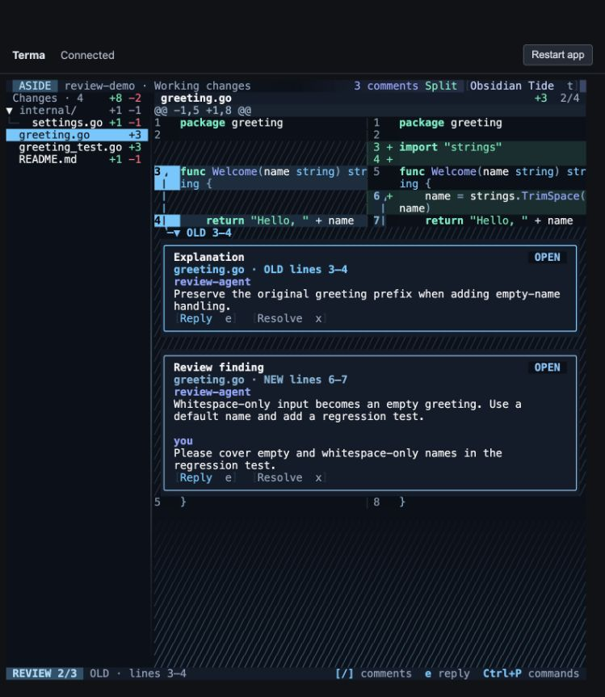
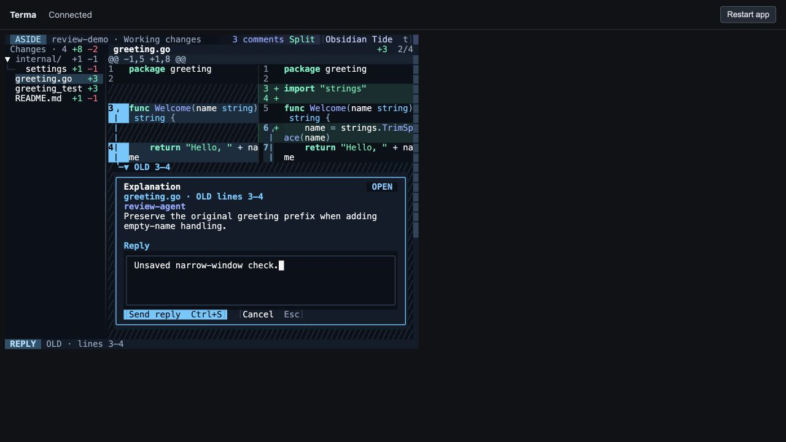

# Review selection and navigation refinements

27 September 2026 · branch `aside` · macOS arm64

The selected range now fills the entire gutter, including change signs and separator spaces. Its solid theme colour has contrasting light or dark text; the source keeps a softer tint so syntax remains readable. The OLD 3–4 connector in `greeting.go` now continues through inserted-line alignment gaps.

Selecting a comment promotes it ahead of other comments at the same source endpoint. Scrolling uses the measured code, card and editor bounds to keep them together when they fit. Stored review order stays unchanged, so previous/next navigation remains predictable.

Cards and composers now have **vertical padding 0, horizontal padding 1**. Extra message/action spacing and the bottom hatch spacer are removed. The footer is one row with a stable BROWSE/REVIEW/REPLY/DRAFT badge, range or action context, and shortcuts that adapt to available width.

## Verification results

| Check | Result |
| --- | --- |
| Full Go suite | **215 passed cases**, including subtests; 173 top-level tests; no failures |
| Snapshots | **14 passed**, all rendered and visually inspected; includes two new regression goldens |
| Race detector | `go test -race ./...` passed |
| Static checks and build | `go vet ./...`, `git diff --check`, and native Aside build passed |
| Full gutter | Buffer assertions cover every gutter cell in unified and split views, and distinguish it from the code tint |
| Theme contrast | Focused gutter text/background contrast is at least 4.5:1 across every registered theme |
| Original OLD 3–4 example | Live browser confirmed the continuous rail across the inserted row and the correct OLD connector |
| Stacked comments | Keyboard and mouse selection promoted the chosen card; previous/next wrapped across files without changing store order |
| Short window | At **80 columns × 32 rows**, selected code, comment, reply editor and buttons were simultaneously visible |
| Persistence and cancel | Ctrl+S saved the exact test reply in an isolated store; Escape left no unsaved narrow-window reply behind |
| Scrolling | Mouse wheel moved the review viewport; comment navigation restored source context |

The initial regression command failed on the gutter gap, broken old-side rail, and missing source code after next-comment navigation. Those same tests now pass. Further coverage includes repeated navigation, wrapped code, divider changes, hidden signs, light themes, outdated comments, overlapping ranges, and conversations taller than the viewport.

Evidence: [results summary](../snapshot-output/evidence/refinement/summary.json), [full test log](../snapshot-output/evidence/refinement/tests.jsonl), [before-fix failures](../snapshot-output/evidence/refinement/before-fix.txt), [race output](../snapshot-output/evidence/refinement/race.txt), [vet output](../snapshot-output/evidence/refinement/vet.txt), [NEW selection](../snapshot-output/evidence/refinement/new-range.jpg), and [reply entry](../snapshot-output/evidence/refinement/reply.jpg).

## Limits and test environment

If a conversation is taller than the window, it cannot all fit beside the code. Navigation keeps the code tail and comment heading visible; replying brings the editor and its actions into view. Promotion applies to comments sharing a rendered source endpoint. Separate source ranges remain in code order.

Manual verification used Terma’s browser PTY with the native Aside binary and a copied review store. Ghostty itself was not automated. A temporary browser viewport override caused unreliable input targeting; it was reset, and final interaction checks used fresh sessions with the launcher's explicit terminal dimensions. Temporary tabs and the launcher were closed after verification. The original Ghostty fixture and its review data were preserved.
