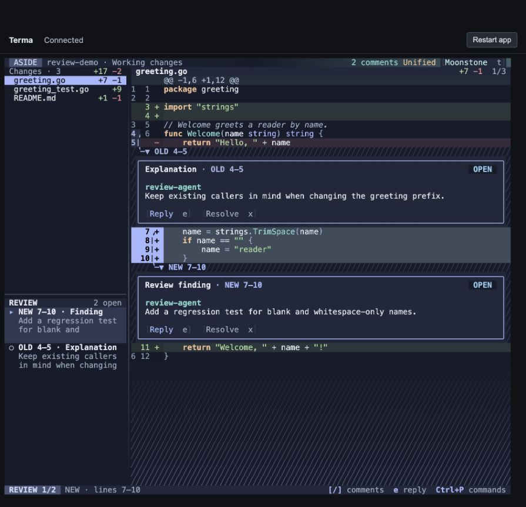
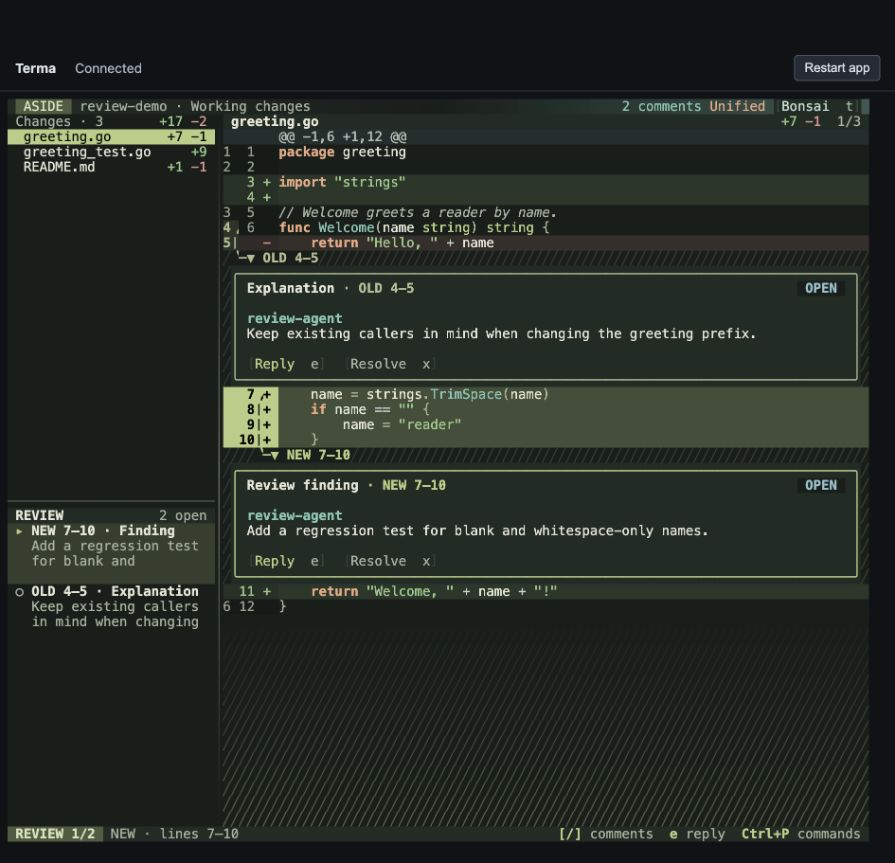
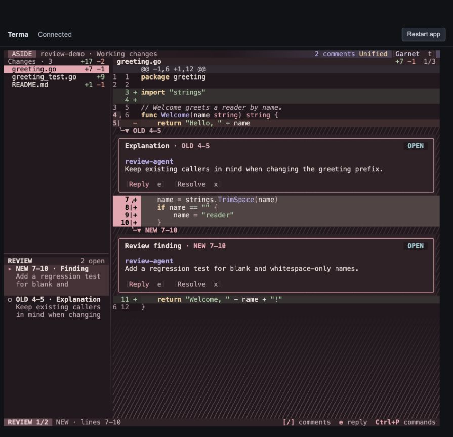
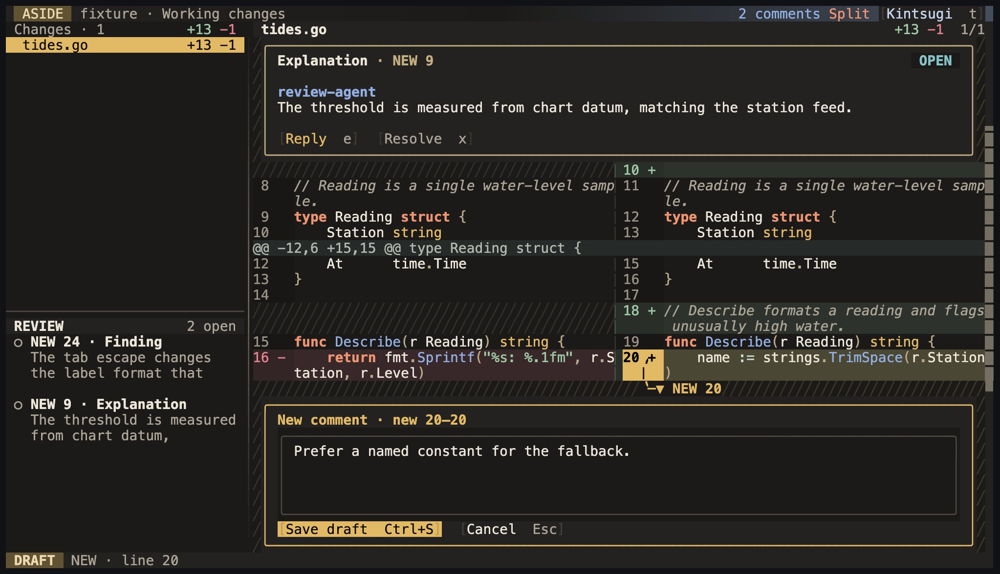
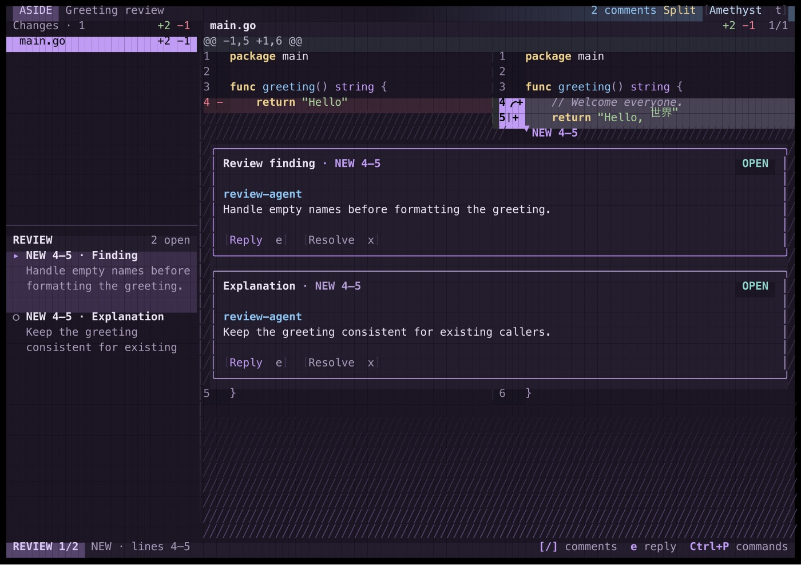
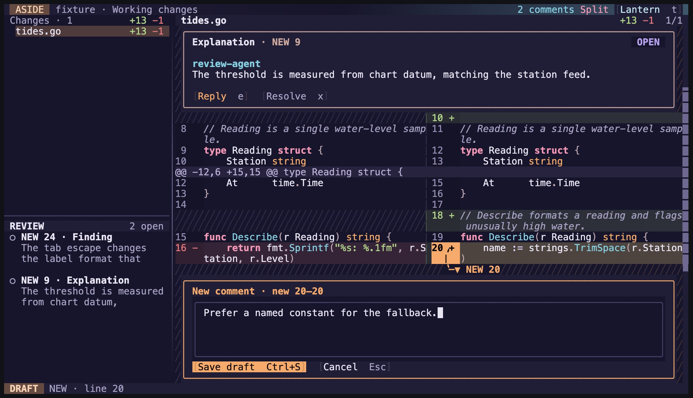

# Aside dark themes

Verified 28 September 2026. Select a theme with `t`, or launch with `aside --theme NAME`.

| Theme | Colors |
| --- | --- |
| Moonstone | Slate blue, lavender, sea glass and peach |
| Bonsai | Forest charcoal, sage, jade and copper |
| Garnet | Dark burgundy, rose, lavender and champagne |
| Kintsugi | Glazed charcoal, gold, indigo glaze and persimmon |
| Amethyst | Violet dusk, amethyst, clear sky and butter yellow |
| Lantern | Indigo night, lantern amber, river cyan and blossom pink |

These palettes register through Terma’s existing `RegisterTheme` API. The existing picker, preview, configuration and CLI validation discover them automatically. Text, syntax, diff backgrounds, selection gutters, review cards, focus, inputs and scrollbars use the theme’s semantic colors.

## Verification

- **235 passing test cases**, including **22 Aside snapshot tests**; `go vet ./...` and `git diff --check` pass.
- Each theme has a snapshot at 120 × 36 with a split diff, selected lines, finding/explanation cards and the review navigator. All six were rendered to PNG and visually inspected.
- Contrast tests require at least **4.5:1** for primary/secondary body text on base, surface and hover backgrounds, and focused selection text. Every syntax role must reach **3:1** on context, added and removed line backgrounds. These are targeted regression checks, not a claim of universal accessibility certification.
- Race tests were not rerun for these palette-only changes; theme registration happens at startup and no concurrency or persistence behavior changed. Native Ghostty rendering was not separately tested.

### Moonstone, Bonsai and Garnet

Browser verification ran the real native binary through Terma’s PTY launcher in the default 895 × 863 browser viewport, with a new disposable Git repository and isolated review store. Inspected all three palettes with a unified diff, new-line selection, old/new anchors, comments and hatched surrounds. Verified live preview, Escape restoring the prior theme, and Enter applying Garnet and Bonsai.

### Kintsugi, Amethyst and Lantern

Browser verification ran the real native binary through Terma’s PTY launcher at 120 × 36 in a split diff, with a disposable Git repository and isolated review store seeded with a finding and an explanation. Verified `--theme kintsugi` at startup, live preview from the picker, Escape restoring Kintsugi, and Enter applying Lantern. Selected a new-side line and opened the comment editor in Kintsugi and Lantern. Amethyst was checked through its snapshot only; its screenshot below is that snapshot, not a browser capture.

## Moonstone

## Bonsai

## Garnet

## Kintsugi

## Amethyst

## Lantern

[Raw test results and screenshots](../snapshot-output/evidence/themes/)
