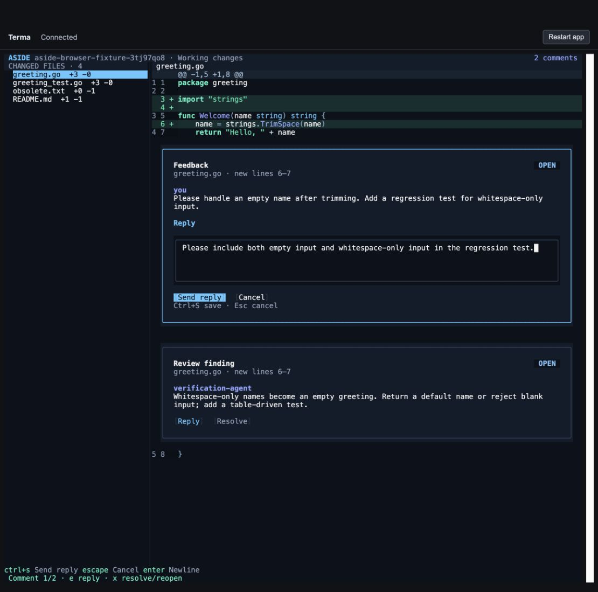
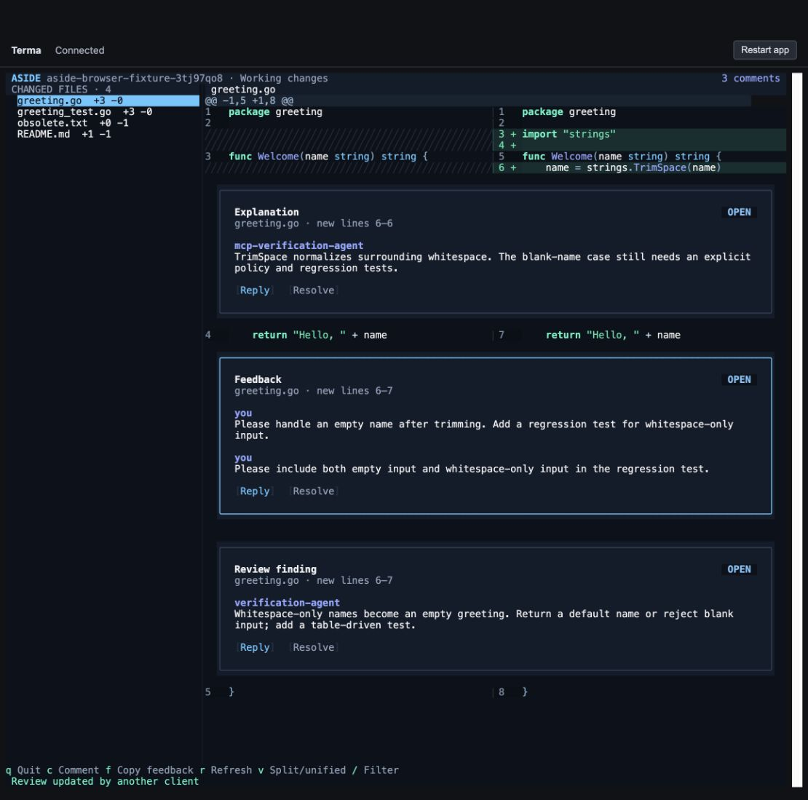
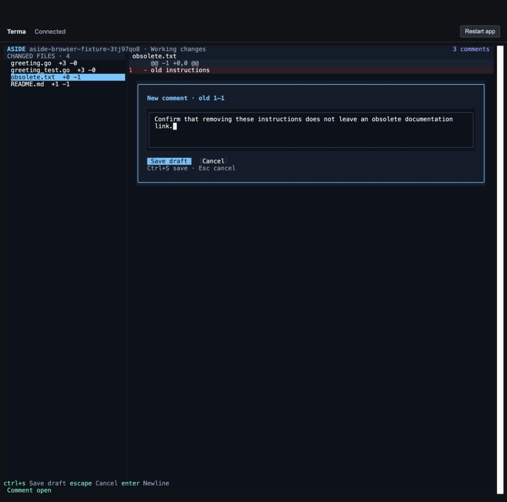

# Aside verification report

Verified on **26 September 2026**, on macOS arm64. This implementation lives on branch `aside`, based on dv's committed `dvdev` state at `a6932e9`, with sibling Terma `ad4d7cd`. The existing dv checkout and its uncommitted changes were preserved.

## Result

Aside provides the file sidebar and unified/split diff, with local inline feedback and agent reviews. Staging, committing, pushing, branch checkout, and PR creation controls and implementations have been removed. Its Git access reads the repository; review writes go to a separate local store.

The initial feedback presentation was replaced during verification. **Comments are now actual Terma widgets interleaved with code sections. Reply editors are children of the thread they reply to; new-comment editors appear beneath the selected lines.** Review text never becomes fake source rows. Cards have mouse-operable Reply and Resolve/Reopen buttons; editors have Save/Send and Cancel controls.

## Checks at a glance

| Check | Observed result | Evidence |
| --- | --- | --- |
| Full Go suite | **181 passed cases including subtests; 0 failures** | [Machine-readable test log](../snapshot-output/evidence/tests.jsonl) |
| UI snapshots | **6 passed**, each rendered and visually inspected | [Goldens](../testdata/) |
| Race detector | **Passed** | [Race result](../snapshot-output/evidence/race.txt) |
| Static analysis | **`go vet ./...` passed**, no diagnostics | [Summary](../snapshot-output/evidence/summary.json) |
| Builds | macOS arm64 built and run; Linux amd64 and Windows amd64 cross-compiled | [Summary](../snapshot-output/evidence/summary.json) |
| Actual MCP process | Handshake, 7 tools, read, publish, idempotent retry, exact quotes, browser reply read-back | [MCP smoke result](../snapshot-output/evidence/mcp-smoke.json) |
| Agent skill | `skill-creator` validation passed | [Packaged skill](../skills/aside-review/SKILL.md) |

The snapshots cover unified view, split view with a finding, a new inline composer, a reply within its card, outdated feedback at 65 columns, and an empty review. The browser runs the same native Aside executable through Terma's PTY launcher, with real terminal input and output.

## Browser checks

A disposable repository and isolated review store were used. The fixture included added Go lines, an untracked test file, a modified README, and a deleted text file.

| Workflow | Expected and observed |
| --- | --- |
| Select code and comment | Selecting new lines 6–7 produced that exact source range and quote. The editor appeared beneath the code. |
| Reply to an existing thread | Mouse Reply opened the editor inside the selected card, after its messages. Ctrl+S persisted the reply, visible through CLI/MCP. |
| Real widget buttons | Mouse Resolve changed the thread to resolved; Reopen restored it. Reply had its own working hit target. |
| Deleted-line feedback | Clicking the removed line opened an editor for `obsolete.txt`, **old line 1**. The saved quote was exactly `old instructions`. |
| Draft privacy and submission | Four threads existed locally while the agent API returned three. Submitting exposed the fourth; Markdown export included its exact anchor, quote, and message. |
| Agent review arriving live | A separate MCP process published an explanation. It appeared in the running app without a reload. |
| Split/unified view | Switching preserved the inline conversations and source references. |
| Empty file filter | A query with no matches showed the empty state; Escape restored the file list and diff. |
| Persistence | Restarting the app retained submitted comments and replies. |
| Changed source | Editing the fixture and refreshing marked earlier comments **OUTDATED**, retaining the original code quote instead of moving them onto new lines. |
| Narrow terminal | At **80 × 35**, the reply text wrapped, the editor stayed inside its card, and Send/Cancel remained reachable. Cancel discarded the unsaved reply. |
| Feedback copy | The native clipboard helper returned success and the UI reported it. Markdown export was independently verified. Native clipboard read-back was not independently confirmed by the browser clipboard API. |

### Reply in context

The editor is part of the thread, with the original message directly above it.



### Live agent review in split view

Human feedback and agent annotations share the same local review and exact code anchors.



### New comment on a deleted line

The input appears beneath the removed source line, and identifies the old side.



### Refresh and narrow layouts

[Outdated-comment screenshot](../snapshot-output/evidence/outdated-refresh.jpg) shows preserved original quotes after the code changes. [80-column reply screenshot](../snapshot-output/evidence/narrow-reply.jpg) shows the nested editor and its controls. [Submitted feedback export](../snapshot-output/evidence/submitted-feedback.md) records the messages and immutable anchors before refresh. [Draft privacy evidence](../snapshot-output/evidence/draft-privacy.json) records the hidden draft before submission.

## Edge cases covered by automated checks

- Exact old/new source coordinates, mixed-side replacement rejection, selection after existing comment cards in unified and split views, and source rows kept separate from review widgets.
- Keeping an active composition on its file; deferring incoming review updates while selecting or composing; finding threads hidden by a file filter.
- Atomic publication of a batch, invalid ranges and missing lines, retry idempotency, reused keys with different contents, concurrent writers, corrupt stored JSON, malformed thread IDs, and path traversal in review IDs.
- Drafts excluded from agent reads and rejected for agent replies/status changes; repository binding enforced for saved reviews.
- Original snapshots and quotes retained after refresh; replies persist; resolve/reopen and revision-based feedback work.
- Staged plus unstaged changes, untracked and empty files, binary files, deleted files, renames, spaces/tabs/newlines/quotes/Unicode in paths, untracked symlinks, and a repository with no commits.
- Repository HEAD, index, and status unchanged by capture. Branch comparison resolves commits without checkout. Mocked PR reads reject a moving head.

## Limits and unverified integration

- The MCP server was tested both through the official Go SDK and a real stdio subprocess. A live Claude Code session and an authenticated GitHub PR were **not** tested. PR capture is covered with a controlled `gh` fixture.
- Linux and Windows were compiled, not run. Remote-terminal OSC 52 clipboard delivery remains explicitly unconfirmed; use Markdown export when needed.
- This version supports inline findings and explanations. Ordered walkthrough chapters and automatic agent wake-up are not implemented; prompt the agent to read submitted feedback.
- Selections stay within one uninterrupted code section; a comment card divides sections. Binary files have no line comments. Untracked files over 2 MiB are represented as binary; untracked symlinks are not followed.
- Snapshot anchors intentionally become outdated when the captured diff changes. There is no automatic relocation onto a new snapshot.
- The local Terma replacement remains intentional. CI checks out the pinned Terma commit, but the updated GitHub Actions workflow has not run remotely.

## Reproduce

From the Aside checkout:

```sh
go test ./...
go test -race ./...
go vet ./...
go build -o /tmp/aside .
(cd ../terma && go build -o /tmp/terma-browser ./cmd/terma-browser)
ASIDE_DATA_DIR=/tmp/aside-test-reviews /tmp/terma-browser -- /tmp/aside --repo /path/to/disposable-fixture --no-config
```

Open the token-bearing URL printed by the launcher. For a fixed terminal size, add `?cols=80&rows=35` before the token fragment. Use the [README](../README.md) for keys, review CLI, and Claude MCP setup. Use the [agent skill](../skills/aside-review/SKILL.md) for publication JSON and the feedback workflow.
