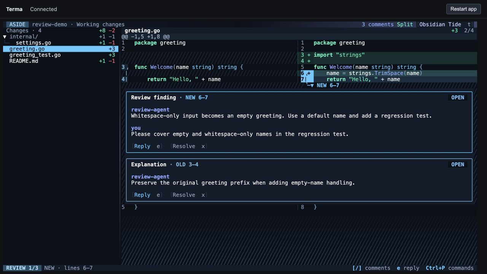

# Adjacent card spacing

Removed the empty connector row before a card immediately following another card or composer. Adjacent borders are now one terminal row apart instead of two. Source connectors and internal message/button spacing are unchanged.

Verification: 215 passing test cases, including 14 snapshots. The one changed golden was rendered and visually inspected. Browser verification at the default viewport confirmed the smaller gap; keyboard navigation and clicking the OLD range header selected and promoted the correct comment. Native `/tmp/aside` rebuilt. The test tab and launcher were closed. No review data was changed.

[Full test results](tests.jsonl)
